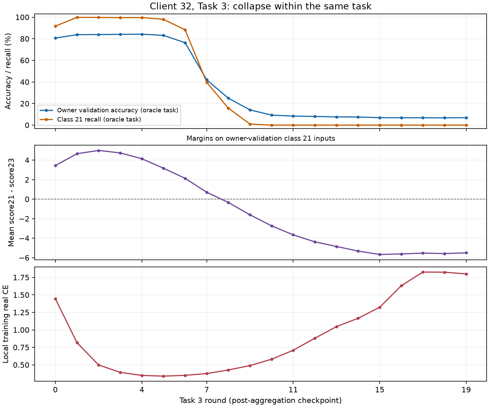

# CANDLE V2 — debug clients có FULL TEST accuracy dưới 10%

Ngày 22/10/2026. Policy hiện tại `binary_cosine_registered_v1`, checkpoint T5/R19.
Đã kiểm tra đúng 3/98 client dưới 10%. Không optimizer, không chạy thêm TEST, không sửa training.

## 1. Danh sách và trần do coverage

| Client | V2 TEST Accuracy | TEST Macro-F1 | TEST route accuracy | TEST coverage / trần accuracy khi giữ availability | V1 Multiclass TEST |
|---|---:|---:|---:|---:|---:|
| 38 | 1.44% | 3.53% | 2.61% | 7.07% | 1.40% |
| 32 | 8.68% | 3.64% | 22.39% | 27.99% | 20.56% |
| 47 | 8.83% | 7.02% | 14.13% | 48.43% | 8.25% |

Coverage được tính bằng số TEST rows có true class nằm trong saved available classes;
empty-scope fallback bằng 0 ở full run. Các số TEST là kết quả đã lưu của results (15).
Không thể quy toàn bộ sai số của ba client cho cùng một lỗi router.

## 2. Client 38 — thiếu coverage là giới hạn lớn nhất

- Chỉ train local T0, T4, T5; không có current BASE ở T1, T2, T3. Saved availability
  gồm 0–5, 24–33, khớp những task đã tham gia và imports trong task đó.
- Các class đã available chỉ phủ 7,07% TEST. Vì vậy **không thể đạt 10%** trên
  shard này nếu giữ nguyên availability, kể cả classifier/router hoàn hảo trên phần đã phủ.
- Owner validation T5: Binary 62,87%, oracle-task 72,36%. Global balanced tail:
  Binary 10,04%, Multiclass 12,90%, oracle-task 18,67%. Những pool này khác phân bố.
- Global tail class 24: oracle recall 100%, Binary recall 0%, route-to-T4 0%.
  Router chặn một capability có sẵn, nhưng sửa router không tự tạo được T1–T3 coverage.
- T5 current BASE trước internal split chỉ có 19 rows: class 31 = 1, class 33 = 18.
  Final real CE 5,56, không có AMP skip ở T4/T5. Không thể gọi đây là training khỏe
  chỉ vì một số class imported đã được đánh dấu available.

**Diễn giải:** Non-IID + vắng task và giới hạn temporal transfer, chưa phải bug mất đăng ký.
Không tự mở class chưa học hay dùng lại dữ liệu train cũ để lấp coverage.

## 3. Client 32 — regression thật xảy ra ngay trong Task 3

- V1 Multiclass TEST 20,56% → V2 Binary TEST 8,68%.
- Vắng T1/T2, nên coverage chỉ 27,99%; ngoài ra model đã phân loại sai cả dữ liệu riêng.
- Exact FP32 terminal T3: owner validation 5.382 rows, oracle-task accuracy **6,93%**.
- Cả **3.797/3.797** owner-validation class 21 bị dự đoán thành class 23, dù biết đúng task.

### 3.1. Trace 20 round đã lưu

| T3 round | Owner oracle accuracy | Class 21 recall | Mean score21 − score23 trên class 21 | Local training real CE |
|---|---:|---:|---:|---:|
| 0 | 80.64% | 91.65% | +3.443 | 1.446 |
| 4 | 84.23% | 99.63% | +4.146 | 0.348 |
| 7 | 41.97% | 39.66% | +0.708 | 0.375 |
| 8 | 24.99% | 15.72% | -0.341 | 0.427 |
| 11 | 8.38% | 0.00% | -3.662 | 0.709 |
| 19 | 6.95% | 0.00% | -5.507 | 1.800 |

Đây là **collapse trong cùng task**, không phải chỉ forgetting sau khi chuyển task.
Row 21 vẫn rank 1 qua R0–R19, optimizer vẫn có steps, T3 không có AMP skip và còn
learner/free capacity. Vì vậy chưa thấy dấu hiệu row bị freeze sớm hoặc backbone hết capacity.

Trên 8 cặp client/task được so bằng cùng owner-validation rows và cùng oracle task mask,
prediction ở checkpoint cuối task và tại T5 **khớp 100%**. Client 32 đã học hỏng T3
trước khi consolidation; các task tiếp theo giữ nguyên những prediction sai đó.

Round checkpoints là FP16 base/deltas. Ở R19, oracle prediction chỉ lệch 1/5.382 rows
so với exact FP32 terminal; cả hai đều class-21 recall 0%. Collapse lớn không được giải
thích bởi sai số lưu checkpoint. Không gọi R4 là best checkpoint hợp lệ cho TEST: R4
được chọn sau khi xem trajectory để chẩn đoán.

### 3.2. Tách head, encoder và BN

Cùng owner validation T3 và cùng 6 class được phép cạnh tranh:

| Features / head | Oracle class accuracy | Class 21 recall |
|---|---:|---:|
| R4 features + R4 head | 84.23% | 99.63% |
| R4 features + R19 head | 2.23% | 0.00% |
| R19 features + R4 head | 34.47% | 10.90% |
| R19 features + R19 head | 6.93% | 0.00% |
| R19 model + R4 BN running statistics | 6.74% | 0.00% |
| R19 model + R4 BN affine/statistics | 6.74% | 0.00% |

FC1 active layout và FC2 connection masks khớp giữa hai trạng thái. Cả head lẫn
encoder đã lệch; thay riêng BN cũ không phục hồi. Source models giữ nguyên hash.
R4 là reconstructed FP16, R19 là exact FP32; đây là functional counterfactual,
không phải một training ablation sạch.

Self-alpha của Client 32 chỉ khoảng 5–8% trong neighborhood ở các round được nêu.
Đó là group weights, **không phải** tỷ lệ tác động thực tế lên từng row sau masks.
Combined local-update/aggregation dynamics là vùng cần kiểm tra. Không có snapshot
pre-aggregation local model, nên chưa thể kết luận peer aggregation hay local objective
là nguyên nhân duy nhất. Không được tự đổi alpha, xi hoặc loss dựa trên kết quả này.

## 4. Client 47 — local fit tốt, global coverage và imported-class discrimination kém

- Owner validation T5: Binary **90,29%**, oracle-task **99,12%** trên 5.909 rows.
- Global balanced tail: Binary 15,29%, Multiclass 17,31%, oracle-task 24,02%.
- Vắng T1/T4; class 21 cũng chưa available. TEST coverage 48,43%.
- Task 3 chỉ có peer 89 ở R0/R1; **18/20 rounds self-only**, không có eligible
  class-21 donor trong các neighborhoods đã ghi. Vì vậy class 21 không được import.
- Đã đăng ký imported classes 12/13/14, nhưng global-tail oracle recall của cả ba
  là **0%**: tất cả 64 mẫu mỗi class bị dự đoán thành class 15. Class 17 chỉ 9,38%.
  Mở mask hay đổi router không sửa được các lỗi phân biệt trong đúng task này.
- Class 19 chỉ nhận virtual training ở 2 rounds; sau đó vẫn available nhưng global-tail
  oracle recall 0%. Availability đang chứng minh có optimizer step, không chứng minh competence.
- Owner accuracy 99,12% bị chi phối bởi các class phổ biến. Nó không chứng minh mọi
  class local hoặc imported đều tốt; các class hiếm vẫn có failure.

**Diễn giải:** coverage, graph isolation, Non-IID generalization và prototype-to-input gap.
Không có bằng chứng model quên toàn bộ kiến thức local.

## 5. Cần làm gì tiếp theo?

1. Ưu tiên Client 32/T3, khoảng R5–R11: lần diagnostic native tiếp theo cần ghi
   cùng current validation trước local, sau local, sau native aggregation, sau
   prototype-row restore và sau BN handling. Giữ nguyên config để định vị thao tác gây hại.
2. So sánh có kiểm soát self-only/native aggregation và V2 loss components sau khi
   có boundary receipts; hiện chưa đủ căn cứ chọn một bản sửa thuật toán.
3. Với 38/47, báo cáo riêng coverage và class competence; không tự unmask class
   thiếu bằng chứng hoặc gọi đặc điểm Non-IID là lỗi implementation.
4. Chưa cần full retrain. Audit này không thay production, không dùng TEST để tune.

Chỉ sửa classifier/router trong availability hiện tại của ba client có trần gain toàn
hệ thống **+0.659 pp accuracy**.
Nếu giả sử cả ba model dự đoán hoàn hảo mọi class, trần gain là
**+2.868 pp**.
Đây là upper bounds, không phải dự báo; ba client xấu nhất không giải thích toàn bộ
accuracy 35,70% của hệ thống.

## 6. Receipts

- Owner/birth diagnostics: `audit_denice/candle_v2_low_accuracy_clients_20261022_v2`.
- Round trace: `audit_denice/candle_v2_client32_T3_rounds_20261022_v1`.
- Component controls: `audit_denice/candle_v2_client32_components_20261022_v1`.
- Tools: `debug_candle_v2_low_accuracy_clients.py`, `debug_candle_v2_client32_rounds.py`,
  `debug_candle_v2_client32_components.py`, `summarize_candle_v2_low_accuracy_clients.py`.
- Member SHA checks, data-role identity và model hashes trước/sau đã kiểm tra.
- Historical validation chỉ vào offline evaluator; không raw replay trong training.
- Một seed, selected-worst analysis trên development đã quan sát; không có untouched confirmation.
