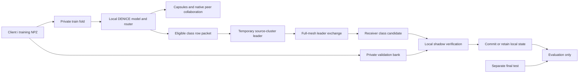

# DENICE with temporary-leader APPLIANCE transfer

Research and implementation report — 14 October 2026

## 1. Recommendation and scope

Use **personalized DENICE with a temporary-leader, class-wise transfer overlay and client-local acceptance**. Keep each client's protected model, router, replay memory and validation bank local. Elect one relay/aggregation participant per effective cluster every round. Exchange class-specific rows through a logical full mesh of leaders. Accept a candidate only after evaluating the actual routed predictor on private positive and negative validation examples.

This is an implementable research design, not a published DENICE variant or a claim of novelty. There is no demonstrated IDS accuracy improvement yet. Count-weighted averaging is established; the particular election rule, compatibility gates, two-stage row transfer and acceptance thresholds are design choices to test.

The strongest limitation is fundamental: a receiver with **no labeled evidence for class c cannot validate recall on c**. A donor's successful validation does not establish performance in the receiver's environment. The delivered method returns `unknown_gap`, retains the current model, and waits for local labeled evidence. It does not manufacture validation data or use the final test set to make transfer possible.

## 2. Materials examined and existing behavior

### Source hierarchy

The supplied `v2.txt` and `pp moi.txt` were read as research proposals, not execution instructions. Relevant repository sources inspected include:

- `train_incremental_kaggle.py`: environment/phase setup, configuration and dispatch.
- `fed_learning/training/decentralized_denice_il.py`: local training, capsules, clustering, aggregation, router updates, task transitions, evaluation and checkpoints.
- `fed_learning/strategies/decentralized/denice_{aggregation,clustering,capsule,transfer}.py`.
- `fed_learning/models/{nice_model,denice_model}.py` and `fed_learning/training/denice_eval.py`.
- `fed_learning/data/incremental_loader.py`, `denice_protocol.md`, `Đề xuất.md`, the existing transfer tests/benchmark, and the clean-training protocol documentation.

The repository contains several generations of DENICE, evaluation experiments, and paper drafts. Statements below refer to the executable paths and explicit configuration, not assumptions based on filenames. The early `denice_protocol.md` describes a multi-cluster-state DFCA concept; the current runner does not implement that draft literally. The research label DENICE is treated as this repository's method. A definitive published DENICE citation/version was not supplied.

### Current entry point and runner

The entry point defaults to phase 5 (fresh tasks 0–5), 100 clients, 34 outputs, 20 rounds/task and one local epoch. These are defaults, not inferred dataset properties. The NPZ metadata defines actual task classes. Other phases download an existing continuation archive. Local uploaded source takes precedence over Git cloning through `DENICE_CODE_DIR`.

The runner initializes clients from a common model template, or bootstraps late joiners from an existing model. Each client owns a DeNICE model and a ContextDetector. Local NICE-based training allocates/protects neurons according to age and updates adapters. Capsules summarize context and label/capacity information. Native aggregation is personalized and age-masked; it does not make all clients equal. In local-delta mode it combines peer local training deltas. Ages are separate from state_dict; adapter compatibility and buffers need explicit treatment.

The current entry-point configuration uses `paper` threshold neighborhoods, not genuine disjoint K-cluster membership. `paper_context_cluster` returns a single sentinel label and a pairwise edge matrix. Therefore, using that label to elect cluster leaders would incorrectly create one global leader. The new preset selects the existing `adaptive_ap` clustering path, whose effective labels define disjoint groups. Invalid clustering reuses a compatible previous partition or falls back to singletons.

Inference extracts adapter-free activation features for the router, predicts an episode, activates that episode's adapters, masks logits to allowed classes and takes argmax. It does not receive true task labels. Consequently, testing only raw classifier logits would not check the system users actually deploy.

Although NICE is described as replay-free in its original paper, the current entry point enables bounded local replay and router replay. Do not describe this configured implementation as replay-free. The preset retains those defaults. The original standalone transfer option searches several full-model mixing weights using local validation and replay proxies; the new overlay is a distinct class-row procedure and disables that selector to avoid confounding.

### What the attached proposals say

`v2.txt` proposes dynamic clusters, a leader chosen by the number of classes actually trained (ties by smallest ID), a common cluster model/router, class/count-based aggregation and leader replacement. `pp moi.txt` proposes APPLIANCE: announce class knowledge; distinguish registration, functional and unknown gaps; select donors; transmit fc2 row/bias/masks; combine rows; protect local knowledge; verify in a shadow model before commit.

**Step 7** in the seven-stage APPLIANCE description is shadow-model verification and acceptance. In the expanded ten-step round description, verification is Step 9 and commit/rollback is Step 10; Step 7 there is row aggregation. The report and implementation use the seven-stage meaning raised by the supervisor.

### Necessary revisions

| Proposal element | Delivered interpretation and reason |
|---|---|
| One shared model/router per cluster | Keep personalized states. Leaders aggregate compatible class packets, not a single overwrite of independently protected models. |
| Cluster only at task start | Reuse the current runner's per-round adaptive clustering; elect immediately after that round's native training and router refresh. This matches changing membership without adding a second clustering implementation. |
| Native collaboration then APPLIANCE | Retained. Native intra-group aggregation runs first; the overlay adds two-stage class transfer. |
| Every missing class can be imported | Revised: no positive/negative receiver evidence means abstention. This method is not zero-shot class acquisition. |
| Donor must have mature parameters | Use trained output age >=1 plus held-out recall eligibility, so current-task knowledge can be shared. Receiver rows with age >=2 are immutable. Requiring donor maturity >=2 would prevent most current-task transfers. |
| Same shape means compatible | Insufficient. Check state schema, adapter registry, non-output masks/ages and class mapping; use actual receiver validation. Exact-feature hashing is an optional restrictive ablation. |
| Collaboration weights for donor rows | Keep native similarity weighting for native aggregation. For the overlay, use a hard competence gate followed by class-count weights; avoid repeatedly optimizing weights on small validation banks. |
| Sharing summaries implies privacy | Rejected. Labels, counts, masks, features, parameters, acceptance and participation can all leak information. |

To avoid using the APPLIANCE holdout to generate clustering capsules, the preset switches `denice_capsule_mode` to `legacy`, which uses training references. The paper CANC controller requires paper-mode capsules in this repository, so the preset also selects legacy CANC and class-block allocation. These are material changes and require a **matched overlay-off baseline**, not comparison only with the original default configuration.

## 3. A — Temporary-server selection

For active group k, let A be available participants, F be simulated failed servers, and H_i the set of labels on which client i has actually trained so far. Select

\[
\ell_k = \arg\min_{i\in G_k\cap A\setminus F}(-|H_i|, i).
\]

Eligibility requires an active client with local training data and a live model in the current round. Historical knowledge is accumulated from post-split training labels; neither transferred labels nor test labels add election credit. Membership and the declaration of availability are inputs to the synchronous simulation. The server role does not receive additional access to client examples.

Election runs every round, after current effective cluster labels are known. There is no forced round-robin rotation: leadership changes when membership, availability, or the ranking changes. Ties use integer client ID. This preserves the user's intended rule and is deterministic. Class breadth is an experience proxy, **not a measurement of compute capacity, trustworthiness or predictive quality**.

An unavailable or failed winner is excluded and the next eligible participant wins immediately. An empty eligible set yields `None`; that group skips the overlay. Empty membership produces no election. Models and routers remain on clients, so replacing a relay does not discard a unique cluster model. Failure during a real in-flight round requires abort/retry with an epoch; the simulation models failure before the transfer phase and packet loss, not crash recovery inside a network transaction.

Participants exchange membership, IDs, availability and historical class sets/counts. They could elect using only breadth counts, but class announcements are separately required for donor discovery in this design. Those announcements can reveal which attacks a site has observed. Self-reported declarations are trusted here; Byzantine-resistant attestation is not implemented.

## 4. B — Discovery and communication

The simulator's directory is the map from effective cluster IDs to elected client IDs. Client membership and elected IDs are available to all simulated actors. All nonempty leader groups form a **logical full mesh**. A client contributes a snapshot once; its local leader relays it to other leaders, and each receiver's leader combines eligible source-cluster contributions. Same-cluster transfers need no inter-leader hop.

Full mesh is deliberately simple for this initial study. It is O(K²) leader connectivity and can become expensive when clustering falls back to many singletons. It is not a scalable discovery protocol or a claim of fully decentralized clustering execution: affinity propagation and round scheduling are centrally computed in this single-process simulation.

Each accepted packet contains task ID, round ID, source client, source cluster, class ID, hash of the class/task mapping, structural/feature signature, snapshot version, training class count, row, bias and output masks. Snapshot versions include a hash of the source state_dict. Packets are captured **before any overlay commits**, so updates are not recursively re-forwarded within a round. Each source/class appears at most once.

Sequence within each round:

1. Local training and native DENICE capsule/clustering/aggregation.
2. Native router refresh, including local replay if enabled.
3. Leader election; donor local checks; immutable packet creation.
4. Logical leader exchange and hierarchical class aggregation.
5. Receiver-side shadow verification; commit only accepted row/bias and availability.
6. Existing round logs/checkpoints; next round or task consolidation.

The implementation requires matching task, round, schema and registered source version, positive counts and finite parameters. Delayed packets from an older round or wrong version are rejected, never buffered into the next round. Dropped updates are omitted and the remaining coordinate denominators are recomputed. No donors means retain local values. `appliance_drop_probability` simulates a lost source/class upload, visible as missing at all recipients; it does **not** simulate independent per-link delays. Unavailability/failure settings affect only the overlay, not the native training that preceded it.

Real deployment would additionally need authenticated participant enrollment and service discovery, endpoint addresses, mutually authenticated encrypted channels, round deadlines, message-size/schema checks, acknowledgments, deduplication, leader epochs/leases, signatures or MACs, atomic versioned commit, retries and durable local checkpoints. A replicated membership directory or consensus service would be an infrastructure choice. None is delivered here. Python objects and function calls represent logical messages; no sockets, encryption, consensus or process isolation are claimed.

## 5. C — Aggregation equations and compatibility

### Native personalized intra-cluster aggregation

The retained adaptive path computes nonnegative similarities s_ij, local training counts n_j and reliability/capacity factors r_j. With the current adaptive defaults,

\[
q_{ij}=\max(s_{ij},0)\log(1+n_j)\max(r_j,0),\quad
\alpha_{ij}=q_{ij}/\sum_{u\in G_i}q_{iu}.
\]

The existing implementation applies a self-weight floor (default 0.25 in the adaptive branch), rescales other weights, and falls back to self-only when total weight vanishes. With `denice_aggregation_rho=reserve`, r_j is the fraction of reserve neurons, **not validation accuracy**. Configured transforms/floors can override these defaults.

For pre-local reference θ_i^0 and local deltas Δ_j=θ_j^local−θ_j^0, the core native update is

\[
\theta_i^{native}=\theta_i^0+eta_{native}P_i\odot
\sum_{j\in G_i}\alpha_{ij}(P_{ij}\odot\Delta_j).
\]

P_i protects mature receiver rows; P_ij applies configured pairwise/label compatibility. Existing adapter and buffer handling remains in the native code. This is personalized masked delta collaboration, not standard FedAvg from one universally shared base.

### Supplemental class aggregation within and across leader groups

For receiver i, class c, coordinate d, eligible donor j supplies row w_jc, binary mask m_jcd and original training count n_jc. A donor must have actually trained c, output age >=1, at least the required local positive/negative evidence, held-out routed recall >=0.7 by default, a matching structural signature and a fresh packet. Eligibility is a filter, not a theorem about generalization.

For source cluster k, form unnormalized sums

\[
S_{kcd}=\sum_{j\in D_{ic}\cap G_k}n_{jc}m_{jcd}m_{icd}w_{jcd},\qquad
Z_{kcd}=\sum_{j\in D_{ic}\cap G_k}n_{jc}m_{jcd}m_{icd}.
\]

The receiver's leader combines clusters:

\[
\bar w_{icd}=\begin{cases}
\frac{\sum_k S_{kcd}}{\sum_k Z_{kcd}},&\sum_k Z_{kcd}>0,\\
w_{icd},&\text{otherwise}.
\end{cases}
\]

Thus each eligible donor's effective coordinate weight is n_jc m_jcd m_icd divided by the total compatible count. Bias uses its own mask and denominator. Equal averaging of cluster means is explicitly avoided: it would overweight small clusters. Packet counts are training examples, not number of epochs, replay appearances, held-out examples or received transfers.

For receiver fc2 age <2, form one preset candidate

\[
w'_{ic}=(1-\eta)w_{ic}+\eta\bar w_{ic},\quad \eta=0.5
\]

and similarly for bias. Mature receiver rows never enter this operation. Unsupported coordinates retain their exact old values. No encoder, BN statistic, adapter, neuron age or structural mask is imported by the overlay.

Unequal sample sizes are represented explicitly by n_jc. Class-wise eligibility avoids averaging rows from clients with no data for that class. Non-IID risk is reduced by native clustering, structural checks, conservative mixing and local acceptance; these do **not** solve arbitrary client drift or distribution shift. Count weighting may still favor a large site's distribution. Compare capped counts and uniform donor weights in later ablations before changing the primary recipe.

Compatibility requires a common architecture and output-label mapping, compatible adapter registry, identical non-fc2 masks/ages, and a common training lineage. Shape equality alone cannot align hidden neurons. The default signature is structural; independently trained encoders can still represent different functions. Actual receiver validation is therefore essential, but remains only sampled evidence. `appliance_exact_features=true` additionally hashes non-fc2 state tensors; it is a very conservative ablation likely to reject nearly all independently trained donors. There is no parameter-alignment theorem here.

## 6. D — Step 7: private, routed validation

### Data and ownership

Before a task's local training, `_split_local_validation` stratifies each client's current NPZ training records. The preset reserves 20% per label, with at least one held-out example where there are at least two records, while retaining at least one training example. Singletons remain training-only. The split seed is the run seed plus task/client offsets. A capped debug dataset is capped before splitting.

The remaining records feed local gradients, replay, training references and router fitting. A `LocalValidator` retains up to 64 validation records per class across tasks in that client's memory. They are never added to training replay, transmitted to donors or merged into a server dataset. The bank is separate from native router/replay memories. The protocol uses a disjoint class-incremental task mapping; repeated class IDs across tasks are rejected.

In deployment, these are locally labeled flow/session examples, obtained from SOC investigations or an existing local annotation pipeline, not labels created by FL. Correct labels are an assumption. For correlated network traffic, split by host/session/time **before producing the NPZ files**. The implemented row-level split cannot prevent overlapping windows or duplicate flows from leaking across partitions. Preprocessing/scaling must be fit on training records only. Dataset provenance, duplicate/session IDs and preprocessing provenance are needed to audit those requirements; they cannot be inferred from numeric NPZ arrays alone.

### Checks and decisions

Each target class needs at least four positive validation examples and four negatives, by default. Retain old validation classes locally to check collateral damage. No sufficient bank means `unknown_gap`. This threshold is a feasibility threshold, not a confidence guarantee.

A shadow copy opens availability for c in its declared episode without changing weights, masks or ages. If it reaches the recall threshold and passes all acceptance constraints, commit registration only. Otherwise, if original routed recall is below the competence threshold, seek compatible donors and evaluate one fixed η candidate. The shadow follows native **hard predicted routing**, including adapters and class masks; true labels are used only for scoring.

Let L_c be mean routed cross-entropy on private class-c examples, R_c their recall, and FP_{u→c} the count of class-u validation records predicted as c. Acceptance requires:

\[
L_c' < L_c-10^{-6},\quad
\forall u\in V_i:\ L_u'\le L_u+10^{-7},\ R_u'\ge R_u,
\quad\forall u\ne c:\ FP_{u\to c}'\le FP_{u\to c}.
\]

Nonfinite losses reject the candidate. The registration-only candidate additionally requires R_c'≥0.7. Rows are processed in sorted class order, evaluating each candidate against the current accepted receiver model; donor snapshots stay fixed throughout the round. This is a conservative empirical veto, not statistical proof of safety. Frozen weights alone also do not guarantee unchanged predictions: a new competing logit can alter argmax.

Only donor eligibility, trained class counts, parameters, masks and protocol metadata are needed by the relay. Per-example predictions and losses used by acceptance remain within `LocalValidator`. The simulator logs receiver/class/reason, donor IDs and acceptance, not those private validation scores. Central simulator access to Python memory remains possible: encapsulation is a protocol convention, not a security boundary.

### Leakage and statistical limits

The final `global_test_data.npz` is used by evaluation, never by `LocalValidator`, donor selection, aggregation weights or acceptance. The preset suppresses mid-training/final-round test evaluation and requests final-task post-task evaluation. Local validation reports remain development metrics. Repeated acceptance decisions adapt models to the holdout, so this bank is a **model-selection/calibration set**, not an unbiased test estimate. Do not choose hyperparameters or best seeds from test outputs.

The repository's clean-training documentation records prior use of development panels from the original test source. Re-running this method does not make that source newly untouched. For a strong new scientific claim, obtain a separate held-out capture/site/time period or disclose historical contamination. Independent audit/test data is required to quantify generalization and acceptance false positives.

No public or synthetic IDS data is assumed by the training method. Public calibration would require compatible features, labels, lawful access and evidence of representativeness. Synthetic calibration would require a validated generator and still would not establish performance on real rare attacks; a private generator itself can leak. These are not silently substituted for unavailable local positives.

No differential privacy or secure aggregation is implemented. Secure summation could hide individual numerator/denominator contributions in sufficiently large cohorts, but would need dropout-tolerant cryptography and would complicate per-donor compatibility checks. Singleton clusters and class-specific sparse cohorts can reveal individual values even through aggregation. Differential privacy requires an adjacency definition, clipping, calibrated noise and accounting across repeated rounds, metadata and validation queries; arbitrary noise is not a privacy guarantee. Both would require a separately evaluated redesign.

## 7. End-to-end algorithms and data flow

```text
for task in metadata order:
    each active client partitions its local task records
    train fold -> local trainer/replay/router
    held-out fold -> private bounded cumulative validator
    for round:
        native local training -> capsules -> effective disjoint clustering
        native age-masked collaboration -> local router refresh
        elect one eligible temporary leader per effective group
        each donor locally checks competence and snapshots eligible class rows
        leaders discover peers through the round directory and relay packets
        discard wrong task/round/schema/version, nonfinite or missing packets
        for receiver, class in deterministic order:
            if insufficient positive/negative evidence: UNKNOWN; continue
            if mature output row: PROTECTED; continue
            try shadow availability-only registration
            if accepted: commit availability; continue
            if routed recall is already adequate: continue
            filter donor structural signatures
            within source clusters: sum count * mask * row, sum count * mask
            across clusters: sum numerators/denominators, normalize once
            blend one candidate at fixed eta
            evaluate private routed shadow against current receiver
            accept -> copy only row/bias and availability; otherwise no mutation
        save native checkpoints plus overlay decision log
    native task consolidation and local validation reporting
final task: evaluate frozen resulting predictors on cumulative test
```



| Object | Owner / storage | Shared? |
|---|---|---|
| Training and validation inputs/labels | Client NPZ and local tensors | No protocol transfer |
| Local replay / router raw references | Client-owned native state | No overlay transfer; simulator checkpoints may contain private state |
| Capsule features, class sets, counts, ages | Native client announcements | Yes; potentially sensitive |
| fc2 row, bias, masks, version/schema | Immutable packet | Yes, via leaders |
| Validation predictions/CE/recall | Local scoring function | No overlay log/export |
| Eligibility, acceptance, failure reasons | Protocol and logs | Yes; leaks competence/participation information |
| Final test truth | Evaluator | Never used for acceptance |

Local files and checkpoints in Kaggle are visible to the notebook process. Do not publish a results dataset containing private replay, router inputs or continuation state without a separate export audit.

## 8. Implementation and configuration

New files:

- `fed_learning/strategies/decentralized/denice_appliance.py`: election, packet validation, structural hashing, two-stage masked row aggregation, private historical validation and commit rules.
- `configs/denice_appliance.json`: explicit research preset.
- `tests/test_denice_appliance.py`: correctness and failure-path tests.
- `tools/smoke_denice_appliance.py`: synthetic three-task integration smoke.
- This report and the source-packaging script.

Modified files:

- `train_incremental_kaggle.py` accepts `DENICE_CONFIG_FILE`; precedence is existing defaults/variant, then file, then `DENICE_CONFIG_OVERRIDES` JSON. The normal behavior stays unchanged when the overlay is disabled.
- `decentralized_denice_il.py` builds the protocol only when enabled, registers local folds, calls it after router refresh and before checkpoints, and adds audit records to cluster summaries and `appliance_rounds.jsonl`.

The new overlay currently supports the native fc2 readout, legacy DENICE learner, local hard routing and the NPZ loader. Alternate learned readouts, other continual-learning variants and the separate clean-meta role pipeline fail clearly rather than silently mixing protocols. **Fresh task-0 training is required.** Evaluation checkpoints include committed parameters/router state through the existing checkpoint machinery, but the private validator/knowledge state is not serialized for exact APPLIANCE training continuation. Resume with the overlay enabled is rejected.

Main parameters: η (`appliance_eta`), minimum evidence, donor/registration recall threshold, per-class bank cap, validation batch size, exact-feature compatibility, source packet-drop probability, unavailable client IDs and failed server IDs. Current failure lists persist throughout the run. Election itself has no random tie-breaking. Random seed controls the native trainer and deterministic packet dropping; set both `seed` and `random_seed` to the same value to preserve existing split-seed conventions.

## 9. Experimental plan

Pre-register the task order, client split, final test source and primary metric before running the expensive IDS experiment. Use at least five paired seeds, e.g. 23, 42, 43, 73, 101. Compare seed-wise differences, means/standard deviations and paired confidence intervals. A claim of superiority needs results across multiple partitions/site distributions, not only one split.

Baselines:

1. Original entry-point DENICE defaults, clearly labeled with its different capsule/CANC/clustering settings.
2. **Matched preset, `appliance_enabled=false`**: primary causal comparison; identical split, clustering, allocation, replay and evaluation.
3. Matched local/self-only aggregation as a collaboration control.
4. Standard FedAvg/FedProx incremental baselines only with matched architecture, local steps, data roles and a specified forgetting-control method; existing repository implementations need separate protocol audits.

Ablations: registration only versus row transfer; same-cluster versus cross-cluster donors; structural versus exact feature signatures; fixed η=0.25/0.5/1; donor competence gate; count versus uniform/capped counts; validation-bank size; old-class constraints; packet loss and unavailable leaders; original versus matched clustering/CANC configuration. Some ablations require small controlled code changes; only parameters explicitly listed above are currently exposed. Do not remove acceptance in a production deployment based on a research ablation.

Measure final cumulative accuracy, macro-F1 over the declared seen labels (including zero-recall labels), balanced accuracy, per-class precision/recall/F1 and confusion matrices. Report benign false-positive rate and attack recall once the benign label mapping is verified. Report per-client mean and dispersion plus sample-weighted pooled metrics separately. These personalized predictors are not a shared-cluster model: do not label client means as cluster-model accuracy.

For incremental learning report task-by-task development accuracy, forgetting and backward transfer. If you evaluate test after each task to form an accuracy matrix A_{t,s}, freeze the entire schedule and do not tune from that matrix; the delivered default runs the final test only at the final task. Standard forgetting is mean over old tasks of max_{u<t} A_{u,s}−A_{t,s}; backward transfer is mean A_{T,s}−A_{s,s}. Existing retention summaries can be used on local validation, with the explicit selection-bias caveat.

Report transfer acceptance rate, unknown-gap rate, no-compatible-donor rate, protected-row rate, actual effective K, leader changes, failure/drop counts, source row payload bytes, local validation compute time, wall time, RAM/VRAM and checkpoint size. `row_payload_bytes` counts unique source row/bias/mask tensors only: it excludes replication across leader links, native messages, hashes, serialization and transport. It is not a measured network bandwidth figure.

Hypotheses to test: supported weak classes may improve; constraints may limit observed old-class damage; structural incompatibility and missing evidence may make transfer rare; validation and full-mesh exchange may erase the expected efficiency gain. A zero-transfer run is a meaningful feasibility finding, not grounds to relax the protocol using the test set.

## 10. Kaggle execution

### Input layout and dependencies

Upload/extract the delivered source bundle so `train_incremental_kaggle.py`, `fed_learning/`, `configs/` and `tools/` are siblings. Upload the dataset independently:

```text
data/
  metadata.json
  client_0_train.npz
  client_1_train.npz
  ...
  global_test_data.npz
```

Each training NPZ needs `X_train` (numeric float-compatible features, shape N×sequence_length×features or the supported 2D layout) and integer `y_train`. Test needs `X_test`, `y_test`. Example metadata:

```json
{"task_structure":{"total_classes":4,"task_classes":{"0":[0,1],"1":[2,3]}}}
```

Client IDs can be listed in metadata or discovered from filenames. Class IDs must be disjoint across tasks and index the classifier outputs consistently. The entry point's `total_classes` must equal the dataset's output dimension; do not keep 34 for another dataset. `data_dir` must name the directory directly containing metadata, not an assumed mount root. The old default is `/kaggle/input/datasets/khoilv2005/100-clients/100-clients`; actual Kaggle mount paths must be checked in the notebook.

Dependencies are in `requirements.txt`: PyTorch, NumPy, pandas, scikit-learn, matplotlib, seaborn, tqdm and pytest (torchvision is an existing repository dependency). Use the notebook's compatible CUDA PyTorch installation rather than blindly replacing it. No extra cryptography/network dependency was added. The requirements are minimum versions, not a lockfile; save `pip freeze` for every real run.

### Notebook cells

```python
from pathlib import Path
import os, json, subprocess, sys, zipfile

archive = Path('/kaggle/input/your-code-dataset/denice_appliance_kaggle.zip')
code = Path('/kaggle/working/appliance_source')
with zipfile.ZipFile(archive) as z:
    z.extractall(code)  # use the trusted bundle produced with this delivery

data = Path('/kaggle/input/your-data-dataset/100-clients')
assert (data / 'metadata.json').is_file()
metadata = json.loads((data / 'metadata.json').read_text())
env = os.environ.copy()
env.update(DENICE_CODE_DIR=str(code), DENICE_TRAIN_PHASE='5',
           DENICE_SEED='42', DENICE_CONFIG_FILE=str(code/'configs/denice_appliance.json'),
           PYTHONUTF8='1')
overrides = {
    'data_dir': str(data),
    'output_dir': '/kaggle/working/appliance_seed42',
    'total_classes': metadata['task_structure']['total_classes'],
    'task_end': max(map(int, metadata['task_structure']['task_classes'])),
    'seed': 42, 'random_seed': 42
}
env['DENICE_CONFIG_OVERRIDES'] = json.dumps(overrides)
```

```python
# Run correctness tests and the synthetic integration smoke first.
subprocess.run([sys.executable, '-m', 'pytest', '-q', '-p', 'no:cacheprovider',
                'tests/test_denice_appliance.py', 'tests/test_denice_transfer.py'],
               cwd=code, check=True)
subprocess.run([sys.executable, 'tools/smoke_denice_appliance.py',
                '--output', '/kaggle/working/appliance_smoke'], cwd=code, check=True)
```

```python
# Optional real-data pipeline smoke: change only these overrides for that run.
# overrides.update(denice_max_clients=2, rounds_per_task=1,
#                  denice_max_train_samples_per_client=128, task_end=0,
#                  denice_eval_max_samples=256)
# Restore full settings and use a NEW output directory for the real experiment.

with open('/kaggle/working/appliance_training.log', 'w', encoding='utf-8') as log:
    subprocess.run([sys.executable, '-u', 'train_incremental_kaggle.py'],
                   cwd=code, env=env, stdout=log, stderr=subprocess.STDOUT, check=True)
with open('/kaggle/working/environment.txt', 'w') as log:
    subprocess.run([sys.executable, '-m', 'pip', 'freeze'], stdout=log, check=True)
```

For a paired baseline, use a separate output directory and change only `appliance_enabled` to false. For new seeds set both seed keys plus `DENICE_SEED`. Full test evaluation over 100 clients can be expensive; if capped, label it a panel rather than full-test evaluation. Full training was not launched by this coding task.

### Outputs

The runner resolves a timestamped output directory and prints it. Inspect `config.json`, `source_audit.json`, `appliance_rounds.jsonl`, `cluster_history.json`, `round_metrics.json`, `task_metrics.json`, `validation_metrics.json`, checkpoint index and task/round checkpoints. Exact native checkpoint names/archives depend on inherited checkpoint settings. Native final evaluation runs automatically; no extra model fitting is needed for its outputs. Use the existing evaluation tools only after confirming their routing and data-role options match this protocol.

`appliance_rounds.jsonl` is the authoritative overlay audit: leaders, task/round, packet and drop counts, source tensor bytes, compatibility mode, and each receiver/class decision. Check unknown/protected/incompatible counts before interpreting accuracy. Simulation logs and continuation checkpoints are research artifacts, not privacy-sanitized exports.

## 11. Verification and remaining requirements

Verification results are recorded in `docs/DENICE_APPLIANCE_TEST_RESULTS.md`, with the synthetic smoke's machine-readable summary under its output directory. Tests check mechanisms rather than claiming training effectiveness. No real IDS accuracy, privacy bound, Byzantine robustness or distributed networking result is supplied.

Needed before a defensible full experiment: exact dataset identity/version/license; class/benign-label mapping; metadata and expected tensor schema; original train/test split procedure and host/session/time identifiers; preprocessing fitting provenance; a genuinely held-out final evaluation source if historical test reuse matters; exact published DENICE reference if paper-faithful reproduction is required; and a deployment threat model if cryptographic privacy is required. Synthetic arrays in this repository do not replace those materials.

## 12. Verified references

1. McMahan et al. (2017), *Communication-Efficient Learning of Deep Networks from Decentralized Data*, AISTATS, PMLR 54:1273–1282. Establishes sample-weighted model averaging; it does not establish compatibility of independently protected DENICE classifier rows. [Proceedings](https://proceedings.mlr.press/v54/mcmahan17a.html).
2. Mustafa Burak Gurbuz, Jean Michael Moorman and Constantine Dovrolis (2024), *NICE: Neurogenesis Inspired Contextual Encoding for Replay-free Class Incremental Learning*, CVPR. Supports the neuron-maturation/contextual-inference foundation, not this FL extension. [CVF paper](https://openaccess.thecvf.com/content/CVPR2024/papers/Gurbuz_NICE_Neurogenesis_Inspired_Contextual_Encoding_for_Replay-free_Class_Incremental_Learning_CVPR_2024_paper.pdf), [official conference record](https://cvpr.thecvf.com/Conferences/2024/AcceptedPapers). The primary search/conference records were verified; direct PDF retrieval returned HTTP 403 in this session. A local `paper/NICE.pdf` is also present.
3. Li et al. (2020), *Federated Optimization in Heterogeneous Networks*, MLSys. Motivates taking statistical/system heterogeneity seriously; the delivered overlay does not implement or claim FedProx convergence guarantees. [Proceedings paper](https://proceedings.mlsys.org/paper/2020/file/1f5fe83998a09396ebe6477d9475ba0c-Paper.pdf).
4. Zhu, Liu and Han (2019), *Deep Leakage from Gradients*. Demonstrates that exchanging learned updates can expose training information; local storage alone is not a privacy guarantee. [Primary preprint](https://arxiv.org/abs/1906.08935).
5. Bonawitz et al. (2017), *Practical Secure Aggregation for Privacy-Preserving Machine Learning*. A cryptographic protocol with concrete assumptions and engineering requirements, not a property obtained by averaging tensors. [Author/publisher record](https://research.google/pubs/practical-secure-aggregation-for-privacy-preserving-machine-learning/).
6. PyTorch, *Reproducibility*. Seeds and deterministic settings help repeatability but do not ensure identical outputs across releases/platforms/devices. [Official documentation](https://docs.pytorch.org/docs/stable/notes/randomness.html).

References motivate components; none is cited as evidence that APPLIANCE improves IDS performance. The method-specific decisions and numerical thresholds above are explicitly proposed design choices.
