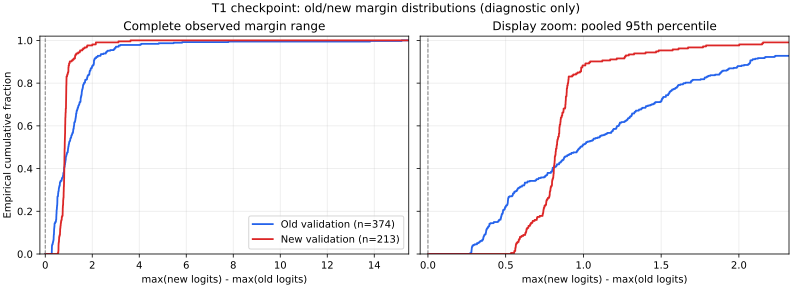

# Routerless V1 — Old-only diagnostic và logit competition

## 1. Trả lời câu hỏi chính

**Sau Task 1, old-only argmax trên `{1,2,3,4,5}` đạt 273/374 = 72,9947%.**

| Prediction / nguồn | Correct / rows | Accuracy |
|---|---:|---:|
| T0 old-only, baseline đã ghi trong receipt | 206/374 | 55,0802% |
| T1 old-only, inference checkpoint T1 hiện có | 273/374 | **72,9947%** |
| T1 cumulative, cùng checkpoint và cùng old rows | 0/374 | **0%** |

Old-only tăng **17,9144 pp** so với baseline. Cumulative competition biến cả
273 old-only correct predictions thành sai. Thông tin để phân biệt nhiều class
cũ vẫn tồn tại; overall collapse không đủ để kết luận model đã mất mọi kiến thức cũ.

**Old-only là oracle-mask diagnostic**, không phải accuracy V2 hoặc inference
deployable. Official inference vẫn argmax trên cumulative registered classes.

## 2. Provenance và giới hạn checkpoint

Không train lại, không fit bias/alignment/threshold, không distillation, không TEST.
T1 file checkpoint khớp SHA256 trong original pilot receipt. Các prepared VALIDATION
files khớp hashes đã ghi; old panel cùng 374 rows/support. T1 cumulative confusion
và old/new margin medians tái lập kết quả cũ; model/state không mutate.

Pilot trước **chỉ persist T1**, không có full T0 checkpoint trên disk. Vì vậy
baseline T055,08%/confusion lấy từ original receipt, **không phải T0 được inference
lại trong audit này**. Không tái tạo T0 bằng training và không thay bằng checkpoint
shallow khác objective. Chưa thể đo T0→T1 activation drift hoặc paired sample
transitions từ T0. Runner đã được sửa để lưu T0 cho các run tiếp theo; không chạy
lại training để lấy file đó trong audit này.

## 3. Old-only class breakdown

| Class | VALIDATION support | T0 recall từ receipt | T1 old-only recall |
|---|---:|---:|---:|
| 1 | 128 | 8,59% | **76,56%** |
| 2 | 20 | **90,00%** | **0%** |
| 3 | 34 | 14,71% | 32,35% |
| 4 | 128 | 93,75% | 88,28% |
| 5 | 64 | 81,25% | 79,69% |

Present-class macro recall: **57,66% →55,38%**, dù sample-weighted accuracy tăng.
Class1 có gain lớn và support128; class2 có loss90pp nhưng support20. Do đó không
được gọi đây là pure competition mà mọi class cũ đều giữ nguyên. Có cả within-old
decision degradation ở class2; chưa đủ dữ liệu để quy riêng cho backbone/BN/FC1.

## 4. Toàn bộ phân phối margin

Đặt `m = max(new logits) − max(old logits)` với old classes1–5, new6/7/8/10.
Các logits được lấy từ cùng model eval, không đổi weights, không dùng true task
để chọn model. True labels chỉ phân nhóm old/new cho thống kê sau forward.

| Statistic | Old panel,374 rows | New panel,213 rows |
|---|---:|---:|
| Minimum | 0,2687 | 0,5343 |
| P05 | 0,3212 | 0,5734 |
| P25 | 0,5147 | 0,7638 |
| Median | **0,9807** | **0,8273** |
| P75 | 1,5482 | 0,8914 |
| P95 | 2,6372 | 1,4739 |
| Maximum | 15,1639 | 3,6271 |
| Mean | 1,2338 | 0,8892 |
| Fraction margin>0 | 100% | 100% |

Ranking AUROC cho “larger margin → new sample” chỉ **0,43717**. Hai phân phối
chồng lấn, có vùng đổi thứ tự và tail old lớn. Không có separation hoàn hảo bằng
một scalar threshold. Chưa thử hoặc chọn scalar bias; AUROC này không dự báo đầy
đủ khả năng của mọi calibration/Weight Aligning algorithm.



CSV có toàn bộ587 row identities/predictions/margins; không chỉ lưu quantiles.
ECDF trái hiển thị toàn range, bên phải là display zoom tới pooledP95, không
phải threshold hoặc giới hạn loại mẫu.

Các integrity checks PASS; **7/7 tests helpers inference/statistics/plot PASS**,
không chạy optimizer hoặc tái train pilot. Xem [test receipt](../artifacts/denice_v2_routerless_old_logits_test_receipt_20261012.json).

## 5. Weight-norm diagnostic

- Mean masked FC2 row norm old: **0,57866**.
- Mean masked FC2 row norm new: **0,57621**.
- Ratio old/new: **1,00425**.

Mean norms gần nhau. Nếu chỉ nhân new weights bằng ratio này, mức thay đổi chỉ
khoảng0,4% và ratio còn lớn hơn1; chưa có bằng chứng rằng norm-only Weight Aligning
sẽ sửa được dominance. Không áp dụng transformation này trong audit.

## 6. Quyết định

Giữ hướng routerless nghiên cứu, chưa full training. Ưu tiên thiết kế một
development protocol cho old/new logit competition trước khi thêm distillation;
không mặc định mean-norm alignment là lời giải. Đồng thời cần giữ class-wise
retention, đặc biệt class2, để không bị overall accuracy che khuất.

Nếu tiếp theo thử alignment/preservation, phải fit trên current BASE hoặc nguồn
được phép theo protocol mới, không chọn hệ số theo374 old VALIDATION labels đã
quan sát. Distillation chưa được triển khai. Strict safety/old-region function
preservation vẫn chưa được chứng minh bởi diagnostic này.

## 7. Artifacts và reproduce

- [JSON receipt](../artifacts/denice_v2_routerless_old_logits_20261012.json)
- [CSV toàn bộ rows](../artifacts/denice_v2_routerless_old_logits_20261012_rows.csv)
- [SVG](../artifacts/denice_v2_routerless_old_logits_20261012_margin_ecdf.svg)
- [PNG](../artifacts/denice_v2_routerless_old_logits_20261012_margin_ecdf.png)

```powershell
.\.venv-audit\Scripts\python.exe tools/audit_denice_v2_routerless_old_logits.py `
  --cache audit_denice/denice_v2_native_p1 `
  --pilot-receipt artifacts/denice_v2_routerless_smoke_20261012.json `
  --out artifacts/denice_v2_routerless_old_logits_repeat.json
```

Command chỉ inference. Output paths phải mới. Nếu có T0 checkpoint thật, có thể
truyền `--checkpoint0`; script sẽ đối chiếu confusion với baseline đã ghi.
